# VCF 9.1.1 + Air-gap + VPC（VNA）+ NFS 獨立 VLAN — 從 bring-up 到驗證（UI step by step）

> 📄 Word 版：[`VCF-VKS-Airgap-NFS-VLAN-Step-by-Step.docx`](VCF-VKS-Airgap-NFS-VLAN-Step-by-Step.docx)

一份從頭到尾的實作文件：

1. **VCF 9.1.1 管理網域，不部署 VCF Management Services（VCFMS）**
2. **VLAN-backed VPC + VNA** 啟用 Supervisor、建立 VKS 叢集
3. **Air-gap**：image 只從外部 Harbor 取得，VKr 從本機檔案匯入
4. **PersistentVolume 放在 NAS（NFS），NFS 走獨立的 VLAN，不經過 VNA**

vSphere / NSX / Installer 的設定全部在 UI 操作並截圖；只有中止 bring-up、NAS 主機安裝、驗證這幾件本來就只能下指令的事用 CLI。所有數值都是 lab 實際值，換到客戶環境時對照 [lab 值 ↔ 客戶環境對照表](#lab-值--客戶環境對照表)。

| 重點 | 做法 | 章節 |
|---|---|---|
| 不部署 VCFMS | VCF Installer bring-up 跑完 NSX，在 VCF Management Platform 開始時中止 | Part A |
| NAS | 獨立 VLAN 7，export NFS 3 給 ESXi 的 vmk 網段 | Part B |
| NFS 不經過 VNA | **ESXi 用專用 vmk3（VLAN 7）掛 NFS datastore + Vmknic binding**；VKS 的 PV 是這個 datastore 上的 VMDK | C-1 |
| VPC + VNA | Transit Gateway → Distributed VLAN Connection（VLAN 6）+ VNA cluster | C-2 |
| Air-gap | Local Content Library 匯入 VKr；Supervisor **Container Registries** 下發 Harbor CA；VLAN 6 / 7 都沒有 NAT | C-3、C-5 |
| VKS | 節點系統碟放 vSAN；guest 預設 StorageClass = NAS | C-6 ~ C-8 |
| 驗證 | Harbor 拉得到、docker.io 拉不到；Pod 寫 1 GiB 到 PV：NAS 收到 1025 MiB、VNA 0.7 MB（對照組經 LB：VNA 1083 MB） | C-9 |

**目錄**

- [架構](#架構)
- [環境](#環境)（含 [lab 值 ↔ 客戶環境對照表](#lab-值--客戶環境對照表)）
- **Part A：VCF bring-up（不部署 VCFMS）**：A-1 Installer 精靈、A-2 中止 bring-up、A-3 VKS 前置準備
- **Part B：NAS**：B-1 NFS 3 export（VLAN 7）
- **Part C：NFS VLAN 7 + VPC / VNA + VKS**：C-1 NFS 儲存、C-2 Transit Gateway + VNA、C-3 VKr、C-4 Supervisor、C-5 Harbor 信任、C-6 library + Namespace、C-7 SubnetSet、C-8 VKS 叢集、C-9 驗證
- [時間](#時間)、[遇到的問題](#遇到的問題)、[附錄](#附錄rwx-的另一種做法)

## 架構


（圖的原始檔：[`img/diagram/architecture.html`](img/diagram/architecture.html)）

| 流量 | 路徑 | 進 NSX / VPC？ | 經過 VNA？ |
|---|---|---|---|
| Pod 對外、拉 Harbor image | 節點 eth0 → VPC → Transit Gateway → VLAN 6 | ✅ | 未量測（不是本文重點） |
| LoadBalancer VIP | VLAN 6 → VNA（LB）→ VPC → 節點 | ✅ | ✅（C-9-4 對照組實測） |
| **PV 讀寫（NFS）** | 節點的虛擬磁碟 → ESXi → **vmk3** → VLAN 7 → NAS | ❌ | ❌（C-9-4 實測） |
| Supervisor / VNA 管理 | 管理網段 | ❌ | ❌ |

### 為什麼 NFS 不會經過 VNA

1. VKS 節點根本不掛 NFS。PV 是 NFS datastore 上的一顆 VMDK，節點只看到一顆虛擬磁碟（`/dev/sdX`）；讀寫由 **ESXi** 轉成 NFS。
2. ESXi 用 **vmk3**（`nas-vlan7` port group，VLAN 7）和 NAS 在同一個 L2 網段，不經過閘道，更不經過 NSX。
3. 掛 datastore 時勾 **Vmknic binding = vmk3**，NFS 一定從 vmk3 出去，不會因為路由表改走 vmk0（管理網段）。
4. NSX / VNA 只處理 VPC 的流量（VLAN 6 的 External Connection；VNA 提供 LoadBalancer 等服務）。VLAN 7 沒有加進 Transit Gateway，不屬於任何 VPC。

> ℹ️ 另一種做法是讓 VKS 節點多一張 eth1 直接掛 NFS（可以 RWX），那條路要在 NSX 建 VLAN 延伸 Subnet，見 [附錄：RWX 的另一種做法](#附錄rwx-的另一種做法)。這份只用「ESXi 掛 datastore」這條，NSX 完全不用為 NFS 做任何設定。

## 環境

| 項目 | 值 |
|---|---|
| 管理網域 | `vcf-m06`：vCenter `vcf-m06-vc01`（10.0.1.198）、NSX `vcf-m06-nsx01`（10.0.1.199）、SDDC Manager `vcf-m06-sddcm01`、vSAN OSA，3 台 nested ESX 9.1.0（10.0.1.195-197） |
| **沒有部署** | VCF Management Services（VSP）、VCF Operations、Fleet、VCF Automation |
| VPC 外部網路 | **VLAN 6**，192.168.16.0/24，閘道 .254，External IP Block `vks-block`（排除 .240-.254） |
| **NAS 網路** | **VLAN 7**，192.168.17.0/24：NAS .20、ESXi vmk3 .21-.23，閘道 .254（沒有 NAT） |
| NAS | `nfs-vks01`（Ubuntu 22.04，離線安裝 nfs-kernel-server），export `/export/vks-ds` 給 192.168.17.0/24，`no_root_squash` |
| 外部 Harbor | `harbor01.home.lab`（10.0.0.86），Harbor v2.15.4，自簽 CA，project `vks-apps`（public） |
| VNA | `vks-vna`，1 台 `vcf-m06-vna01a`（10.0.1.209），Large |
| Supervisor 管理 IP | 10.0.1.222-226 |
| DNS / NTP | 10.0.0.200 / 10.0.1.254 |

DNS（A + PTR）要先建好。即使 VCFMS、Ops 等元件不會部署，精靈驗證仍要求它們的 FQDN 能正反解：

| FQDN | IP | 會不會部署 |
|---|---|---|
| `vcf-m06-esx01..03` | 10.0.1.195-197 | ✅ |
| `vcf-m06-vc01` | 10.0.1.198 | ✅ |
| `vcf-m06-nsx01`（VIP）/ `vcf-m06-nsx01a` | 10.0.1.199 / .200 | ✅ |
| `vcf-m06-sddcm01` | 10.0.1.201 | ✅ |
| `vcf-m06-ops01` / `opsc01` / `lic01` / `fleet01` / `vsp01` / `shared01` / `vidb` | 10.0.1.202-208 | ❌ 只為了通過驗證 |
| VCF management services IP pool（12 個） | 10.0.1.210-221 | ❌ 只為了通過驗證 |
| `vcf-m06-vna01a`（VNA） | 10.0.1.209 | ✅（C-2） |
| Supervisor 管理 IP | 10.0.1.222-226 | ✅（C-4） |

### lab 值 ↔ 客戶環境對照表

| 項目 | lab 值 | 客戶環境要準備 / 填寫 |
|---|---|---|
| DNS / NTP | 10.0.0.200 / 10.0.1.254 | 內部 DNS（A + PTR）、NTP |
| 管理網段 | 10.0.0.0/23，gw 10.0.0.1 | ESXi / vCenter / NSX / SDDC Manager 管理網段 |
| ESXi ×3 | 10.0.1.195-197 | 管理網域主機 |
| vCenter / NSX VIP / NSX 節點 / SDDC Manager | 10.0.1.198 / .199 / .200 / .201 | 各 1 個 IP + FQDN |
| VCFMS / Ops 等 FQDN（只為通過驗證，不會部署） | 10.0.1.202-208 + IP pool 10.0.1.210-221 | 仍需 A + PTR（精靈必填） |
| VNA 節點 | 10.0.1.209（管理網段） | 每個 VNA 節點 1 個管理 IP + FQDN |
| Supervisor 管理 IP | 10.0.1.222-226（5 個連續） | 管理網段 5 個連續 IP |
| VPC 外部網路 | **VLAN 6**，192.168.16.0/24，gw .254 | VPC 對外 VLAN + 閘道 |
| External IP Block | `vks-block` = 192.168.16.0/24，排除 .240-.254 | LB VIP / Supervisor API / 節點用的 IP 段 |
| **NAS 網路** | **VLAN 7**，192.168.17.0/24 | NAS 專用 VLAN（不要加進 Transit Gateway） |
| NAS | 192.168.17.20，`/export/vks-ds`（NFS 3） | 客戶 NAS 的 IP / export path，export 給 vmk 網段、`no_root_squash` |
| ESXi NFS vmk | vmk3，192.168.17.21-23，MTU 1500 | 每台主機 1 個 VLAN 7 IP；MTU 跟 NAS 一致 |
| Harbor | `harbor01.home.lab`（10.0.0.86），自簽 CA，project `vks-apps` | 客戶 registry FQDN、CA 憑證、project |
| VKr | `photon-5-amd64-v1.36.2---vmware.2-vkr.3`（11.87 GB） | 依 VKS 版本挑 VKr，搬進內網 |
| 名稱 | `vcf-m06-*`、`vks-lab`、`vks-cl01`、`nas-vks-ds`、`vks-nas` | 依客戶命名規則 |

## Air-gap 的範圍

| 網段 | 對外 | 說明 |
|---|---|---|
| VLAN 6（Supervisor 工作網路、VKS 節點、LB VIP） | ❌ 本來就出不去 | 上游閘道沒有替這段做 NAT |
| VLAN 7（NAS、ESXi vmk3） | ❌ 本來就出不去 | 上游閘道沒有替這段做 NAT |
| Harbor VM | ❌ 用 iptables 擋 | 只放行私有網段 |
| 管理網段（Installer、vCenter、ESX、NSX、SDDC Manager） | ⚠️ 這個 lab 沒有擋 | 所有內容都只從內部來源取得（內部 depot、本機檔案、Harbor）。**正式 air-gap 環境這段也要斷** |

# Part A：VCF bring-up（不部署 VCFMS）

## A-1 VCF Installer 精靈（UI）

Installer 首頁：depot 已連到內部 offline depot，9.1.1 的元件都已下載。按 **DEPLOYMENT WIZARD → VMware Cloud Foundation**。


**Deployment Paths** 選 **Deploy a new VCF fleet**。


### Plan

| 步驟 | 設定 |
|---|---|
| 1 Existing Component | 只勾 **I have an existing VCF Automation instance or I will deploy later**（不部署 VCF Automation） |
| 2 Size Options | Deployment model **Simple**、size Small |
| 3 Network Options | **CUSTOMIZE**：VM management network = **Use ESX management network**；VCF management network = Use VM management network；VPC = **VLAN backed VPC**（Gateway Connectivity 只剩 Distributed） |
| 4 Storage | vSAN，architecture **vSAN OSA** |
| 5 Review Prerequisites | 3 hosts / 52 vCPU / 155 GB / 6748 GB / 4 VLANs |


資源需求明細：其中 **VCF management services 就佔 28 vCPU / 58 GB / 2900 GB**，這次不會部署，但精靈仍以完整需求檢查。


### Prepare

| 步驟 | 設定 |
|---|---|
| 1 General Information | 9.1.1.0、instance `vcf-m06-instance`、domain `vcf-m06`；DNS / NTP / suffix；**CEIP 關閉、Autogenerate passwords 關閉** |
| 2 Hosts | 3 台 FQDN + root 密碼 → **CONFIRM ALL FINGERPRINTS** → NEXT 跳出 *Resource Requirements Warning*（資源夠，但沒有 20% 餘裕）→ **YES, PROCEED** |
| 3 Networks | ESX mgmt VLAN 0 / `10.0.0.1/23`；VCF Management Services IP Pool `10.0.1.210-10.0.1.221`；vMotion / vSAN VLAN 0、`192.168.65.1/24` / `192.168.66.1/24`、各 .11-.20 |
| 4 VCF Management | Ops `vcf-m06-ops01`、Cloud Proxy `vcf-m06-opsc01`、License Server `vcf-m06-lic01`、Fleet / Instance / Identity Broker / services runtime FQDN（**全部不會部署**，只是必填） |
| 5 vCenter | `vcf-m06-vc01`、datacenter `vcf-m06-dc01`、cluster `vcf-m06-cl01`、`vsphere.local` |
| 6 Storage | vSAN OSA，**FTT 固定為 1**（UI 不能改） |
| 7 Distributed Switch | **Default** profile（一個 VDS、MTU 9000、vmnic0/1）；VLAN backed VPC **沒有 TEP 欄位** |
| 8 NSX Manager | VIP `vcf-m06-nsx01`、appliance `vcf-m06-nsx01a` |
| 9 SDDC Manager | `vcf-m06-sddcm01`（Installer 不在這三台主機上，所以會另部一台 SDDC Manager） |


> 🔑 選 **VLAN backed VPC** 時，Networks 頁**沒有** Transit Gateway / 外部網路的欄位，Day-0 只會建立預設 Transit Gateway；外部連線（VLAN、閘道、IP block、VNA）在 bring-up 之後才從 vCenter UI 設定（C-2）。

### Deploy


驗證 15 項，3 個 Warning，全部按 **ACKNOWLEDGE ALL WARNINGS**：

| Warning | 原因 |
|---|---|
| vMotion / vSAN 閘道 `.1` 沒有回應 | 這兩段 lab 不路由，正常 |
| *Insufficient Storage. 5400 GB storage is less than the required 6748 GB* | 6748 GB 含 VCFMS 的 2900 GB；FTT=1 時 3 × 3600 GB 只算一半。VCFMS 不會部署，所以可以忽略 |
| 建議至少 65 cores | nested lab |


**DEPLOY**：


## A-2 在 VCF Management Platform 開始時中止 bring-up（CLI）

9.1.1 greenfield 的 milestone 順序：

1. Deploy vCenter
2. Deploy SDDC Manager
3. Configure vSphere cluster
4. Deploy and configure NSX
5. **Deploy and configure VCF Management Platform** ← 第一個 subtask #271/#272 *Deploy VCF Management Services via SDDC Manager* 就是 VSP bootstrap
6. Deploy and configure the operations appliance
7. Deploy and configure VCF Management Services

在第 5 個 milestone 一開始就中止，前 4 個完成的東西（vCenter、SDDC Manager、vSAN、NSX）都保留。

```bash
# 觸發時（#272 Deploy VCF Management Services via SDDC Manager 開始執行）
systemctl stop domainmanager       # VCF Installer：不再往下跑
systemctl restart domainmanager    # SDDC Manager：中斷剛送出的 VSP_BOOTSTRAP 任務
# 刪掉 inner vCenter 上 VSP 相關的 VM（這次還沒建立就被中斷，沒有東西要刪）
systemctl start domainmanager      # VCF Installer：恢復服務，保留可重用
```

這次用監看程式 [`scripts/abort_watcher.py`](scripts/abort_watcher.py) 自動執行（每 10 秒查 `/v1/sddcs/{id}`；加了兩道保險：NSX milestone 必須已完成、`PREVALIDATION_*` 狀態不算開始）。紀錄見 [`cli/01-abort-watcher.log`](cli/01-abort-watcher.log)：

```text
2026-10-13 14:09:32 >>> TRIGGER: [('Update VCF Management Services Deployment Status', 'POSTVALIDATION_COMPLETED_WITH_SUCCESS'), ('Deploy VCF Management Services via SDDC Manager', 'POSTVALIDATION_COMPLETED_WITH_SUCCESS'), ('Monitor VCF Management Services Deployment Task', 'IN_PROGRESS')]
2026-10-13 14:09:32 step 1: stop domainmanager on installer 10.0.1.135
2026-10-13 14:09:36   systemctl is-active → failed（已停止）
2026-10-13 14:09:36 step 2: restart domainmanager on SDDC Manager 10.0.1.201(砍掉進行中的 VSP 任務)
2026-10-13 14:09:47   systemctl is-active → active
2026-10-13 14:09:47 step 3: 等 60 秒,刪除 inner vCenter 上 VSP 相關 VM
2026-10-13 14:10:47   VSP-looking VMs: none
2026-10-13 14:10:47 step 4: start domainmanager on installer 10.0.1.135
2026-10-13 14:10:55   systemctl is-active → active
2026-10-13 14:10:55 ABORT COMPLETE — 之後 30 分鐘每 2 分鐘確認沒有重送 / 沒有新的 VSP VM
（post-check：之後 30 分鐘每 2 分鐘確認一次）
2026-10-13 14:12:56   post-check installer status=COMPLETED_WITH_FAILURE running=[] vsp_vms=[]
2026-10-13 14:41:13   post-check installer status=COMPLETED_WITH_FAILURE running=[] vsp_vms=[]
2026-10-13 14:41:13 POST-CHECK DONE
```

中止後 Installer 顯示前 4 個 milestone 完成、VCF Management Platform 失敗（4/14）。**不要按 RETRY AND PROCEED WITH DEPLOYMENT**，否則會繼續部署 VSP。


inner vCenter 只有 vCenter、SDDC Manager、NSX 三台 VM：


## A-3 VKS 前置準備（UI）

### A-3-1 vSphere Client 語言改成 English（🔴 一定要做）

右上角使用者 → **My Preferences → Language → Specify a language → English** → SAVE。Namespace → Resources（LCI 外掛）只有 en / es / fr / ja 四種語系，用繁體中文介面會整片空白。


### A-3-2 叢集 HA / DRS

bring-up 完成的叢集已經是 vSphere HA 開啟、DRS **Fully Automated**（Cluster → Configure → Services）。


### A-3-3 vSAN Health 靜音（nested 才需要）

Cluster → Monitor → **vSAN → vSAN Health**：Unhealthy 有 *NVMe device is VMware certified*、*Performance service status*，Info 有 *vSAN Support Insight*。三項都 **SILENCE ALERT → YES**。


### A-3-4 VM Storage Policy `vks-ftt0`

**Policies and Profiles → VM Storage Policies → CREATE**：

| 精靈頁 | 設定 |
|---|---|
| Name and description | Name `vks-ftt0`、**K8s Compliant Name `vks-ftt0`**（沒有自動帶出時要自己填） |
| Policy structure | 勾 **Enable rules for "vSAN" storage** |
| vSAN → Availability | 先關掉 **vSAN ESA Auto-RAID (9.1 onwards)**（這套是 OSA）→ Site disaster tolerance *None - standard cluster*、Failures to tolerate **No data redundancy** |
| vSAN → Advanced Policy Rules | **Force provisioning** 打開 |
| Storage compatibility | `vcf-m06-cl01-ds-vsan01` 相容 |


### A-3-5 Port group 安全性（nested 限定）

Supervisor control plane VM 接在 `SDDC-DPortGroup-VM-Mgmt`。nested 環境要把 **Promiscuous mode / MAC address changes / Forged transmits** 改成 **Accept**（Networking → port group → Configure → Policies → EDIT... → Security）。


### A-3-6 確認 VLAN 6 到得了閘道、但出不了網際網路

臨時 port group + vmk 測試，測完就刪：

1. VDS `vcf-m06-cl01-vds01` → ACTIONS → **New Distributed Port Group**：`tmp-vlan6-test`、VLAN **6**

   
   

2. `vcf-m06-esx03` → Configure → VMkernel adapters → **ADD NETWORKING** → VMkernel Network Adapter → `tmp-vlan6-test` → 服務都不勾 → Static `192.168.16.240/24`

   
   
   
   

3. 從新的 vmk ping 閘道（[`cli/00-vlan6-ping.txt`](cli/00-vlan6-ping.txt)）。bring-up 後 nested ESX 的 SSH 是關的，所以用 PowerCLI `Get-EsxCli -V2` 透過 vCenter 執行同一個 esxcli：

   ```text
   esxcli network diag ping -H 192.168.16.254 -I vmk3 -c 3
   Transmitted : 3   Received : 3   PacketLost : 0
   ```

4. 移除 vmk3（VMkernel adapters → ⋮ → **Remove**），再刪掉 `tmp-vlan6-test`（ACTIONS → **Delete**）。這個測試用的 vmk3 一定要刪，C-1 會在每台主機重新建一個給 NFS 用的 vmk3

   

VLAN 6 本身出不了網際網路（[`cli/00-vlan6-no-internet.txt`](cli/00-vlan6-no-internet.txt)：閘道以 192.168.16.254 為來源 ping 8.8.8.8 全部逾時；以管理網段位址為來源則通）。

### A-3-7 DNS

VNA 節點 `vcf-m06-vna01a.home.lab` ↔ 10.0.1.209（A + PTR，[`cli/00-dns-vna.txt`](cli/00-dns-vna.txt)）；Harbor `harbor01.home.lab` ↔ 10.0.0.86。

# Part B：NAS

## B-1 NAS（NFS 3 export，VLAN 7）

Lab 用一台 Ubuntu 22.04 VM 模擬 NAS，接在 VLAN 7。**正式環境就是客戶的 NAS 設備**，只要：

- 在 VLAN 7 上 export 一個 NFS 3 share，允許 ESXi vmk 網段（lab：192.168.17.0/24）讀寫
- 開 `no_root_squash`（ESXi NFS 3 以 root 建立檔案）
- MTU 和 ESXi vmk 一致（lab：1500）

Lab 的做法（air-gap 離線安裝）：

```bash
# 1. 有網路的 Ubuntu 22.04 上打包 nfs-kernel-server 及相依 deb（scripts/nas/download-nfs-packages.sh）
./download-nfs-packages.sh                 # → nfs-offline-bundle.tar.gz
```

```powershell
# 2. 外層 vCenter：Ubuntu 22.04 cloud image OVA → cloud-init 設靜態 IP 192.168.17.20/24、gw .254（scripts/nas/Deploy-VksNfsVm.ps1）
$env:VIPASS='...'; $env:NFSPASS='...'
.\Deploy-VksNfsVm.ps1
```

```bash
# 3. NFS VM 上（沒有網路）：離線安裝、建 export（scripts/nas/install-vks-nfs.sh）
#    只裝「沒裝或比較新」的 deb，不會把系統的 libc6 / dpkg 降版
tar -xzf nfs-offline-bundle-jammy.tar.gz && sudo ./install-vks-nfs.sh 192.168.17.0/24
```

結果（[`cli/10-nas-server.txt`](cli/10-nas-server.txt)）：

```text
$ sudo exportfs -v
/export/vks-ds   192.168.17.0/24(sync,wdelay,hide,no_subtree_check,sec=sys,rw,secure,no_root_squash,no_all_squash)
$ timeout 5 bash -c 'echo > /dev/tcp/8.8.8.8/53' || echo ...
no internet（VLAN 7 沒有 NAT）
```

> ℹ️ `install-vks-nfs.sh` 另外建了 `/export/vks-rwx`，是給附錄的 RWX 做法用的；本文只用 `/export/vks-ds`。

# Part C：NFS VLAN 7 + VPC / VNA + VKS

## C-1 NFS 儲存走 VLAN 7（UI）

### C-1-1 Port group `nas-vlan7`

VDS `vcf-m06-cl01-vds01` → **ACTIONS → Distributed Port Group → New Distributed Port Group**：Name `nas-vlan7` → VLAN type **VLAN**、VLAN ID **7**（其他預設）→ FINISH。

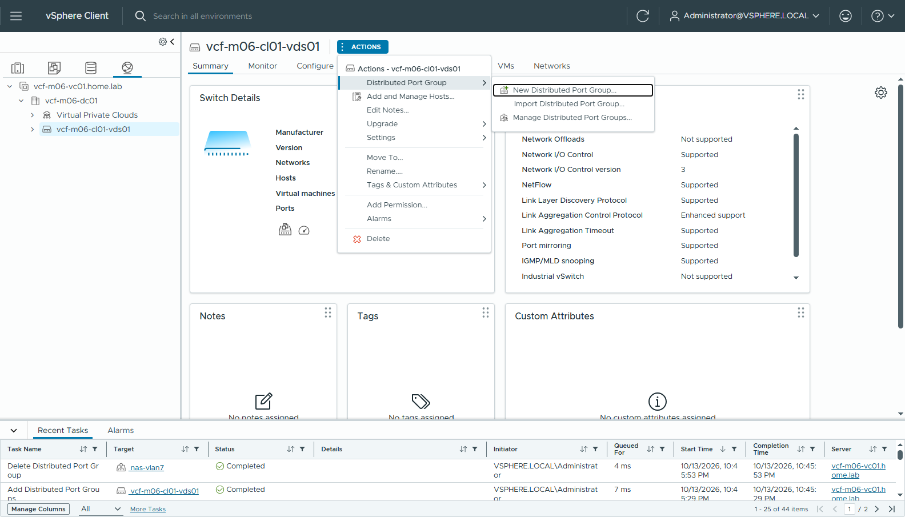

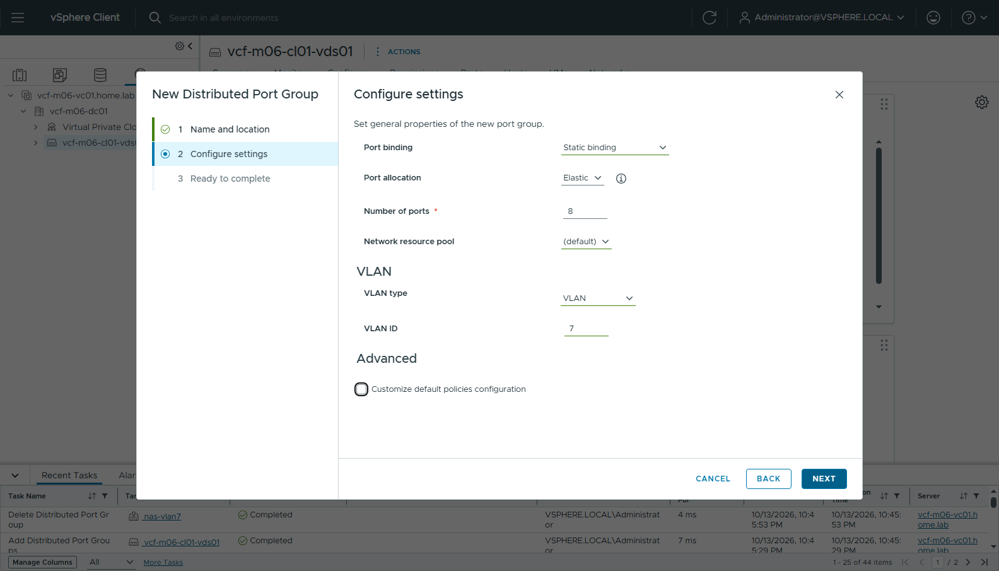


> NFS 用的 port group 不需要 Promiscuous / Forged transmits（那是給 nested 的 Supervisor / VNA 用的）。

### C-1-2 每台主機加 vmk3

主機 → **Configure → Networking → VMkernel adapters → ADD NETWORKING**：

| 精靈頁 | 設定 |
|---|---|
| Connection type | VMkernel Network Adapter |
| Target device | Select an existing network → `nas-vlan7` |
| Port properties | **不勾任何服務**（NFS 不需要勾 service；vMotion / vSAN 都不要）；MTU 選 Custom 填 **1500**（要和 NAS 一致；不選的話會沿用 VDS 的 MTU） |
| IPv4 settings | Static：`192.168.17.21` / `255.255.255.0`（esx02 = .22、esx03 = .23）。**不要**改 default gateway：NAS 和 vmk3 在同一段 |

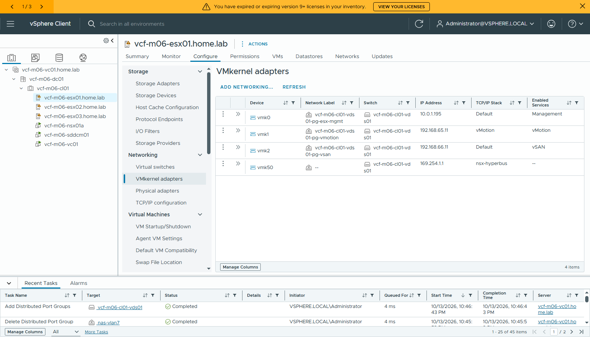


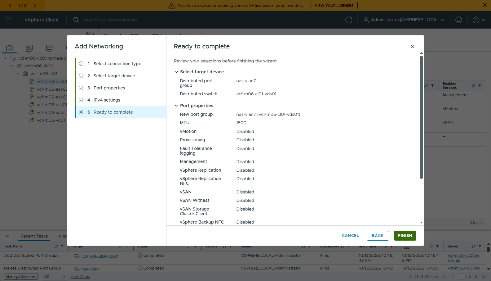


三台做完，用 vmk3 ping NAS（nested ESX 的 SSH 是關的，用 PowerCLI `Get-EsxCli -V2`，[`scripts/Test-NasPing.ps1`](scripts/Test-NasPing.ps1)，[`cli/11-vmk3-ping.txt`](cli/11-vmk3-ping.txt)）：

```text
vcf-m06-esx01.home.lab  vmk3 -> 192.168.17.20  sent 3 / recv 3  rtt avg 504 us
vcf-m06-esx02.home.lab  vmk3 -> 192.168.17.20  sent 3 / recv 3  rtt avg 603 us
vcf-m06-esx03.home.lab  vmk3 -> 192.168.17.20  sent 3 / recv 3  rtt avg 556 us
```

### C-1-3 NFS datastore `nas-vks-ds`（Vmknic binding = vmk3）

叢集 `vcf-m06-cl01` → **ACTIONS → Storage → New Datastore**：

| 精靈頁 | 設定 |
|---|---|
| Type | **NFS** |
| NFS version | **NFS 3** |
| Name and configuration | Name `nas-vks-ds`、Folder `/export/vks-ds`、Server `192.168.17.20`、**勾 Vmknic binding** |
| Hosts accessibility | Select all（3 台） |
| **Vmknic bindings** | Vmknics on all hosts → **vmk3** |


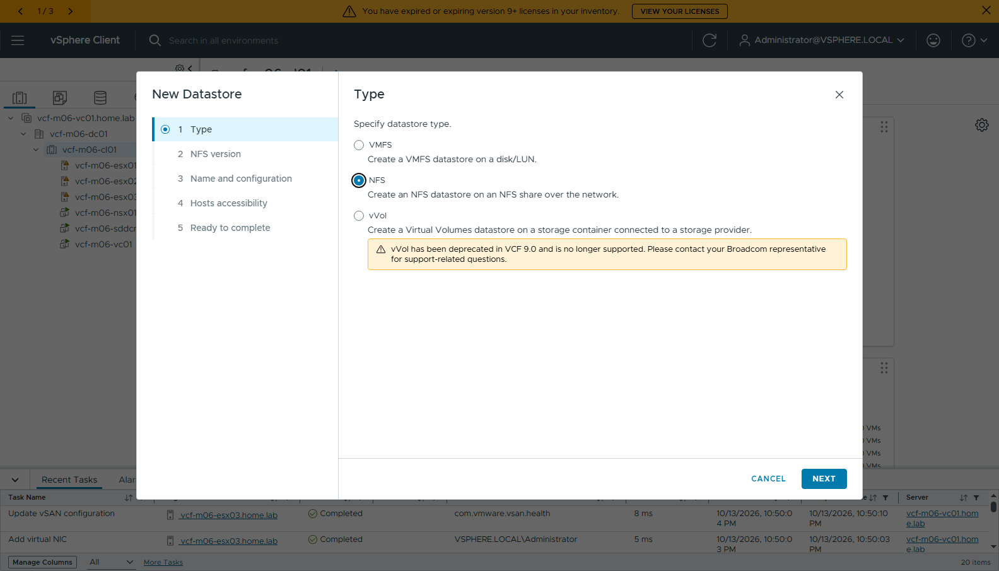

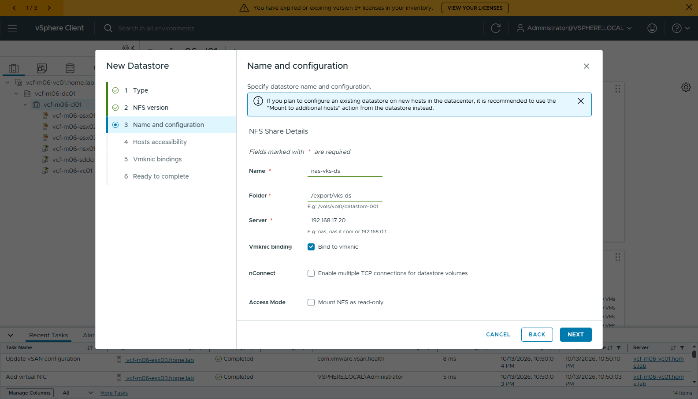
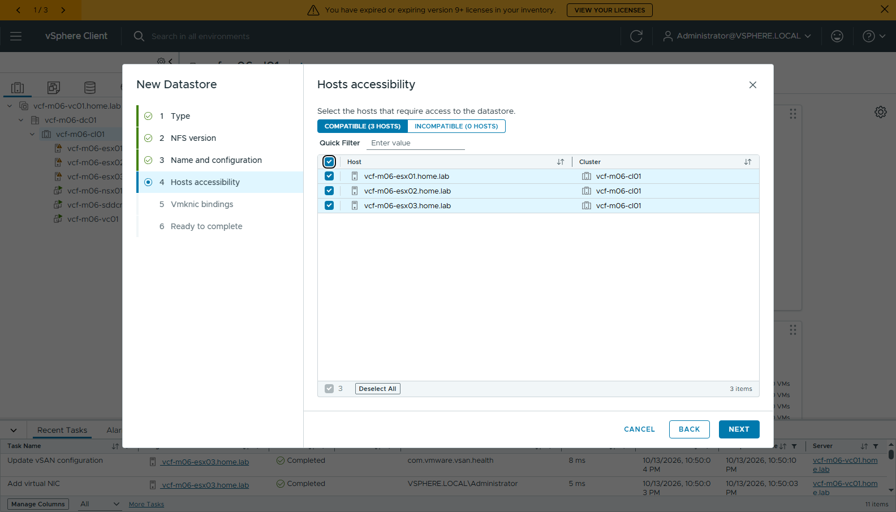
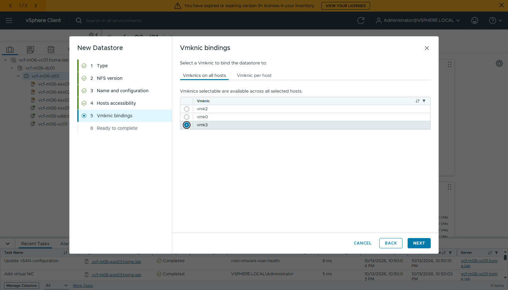
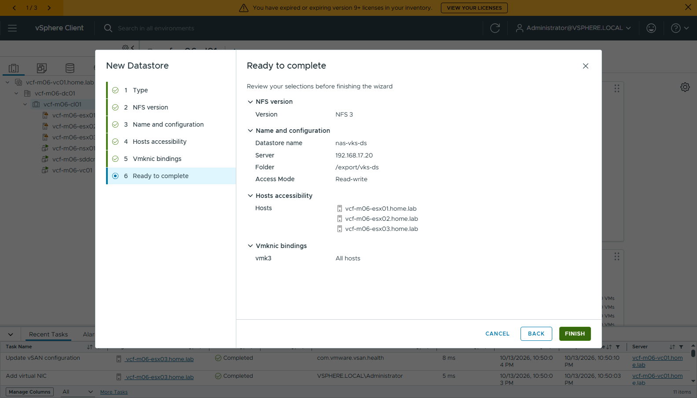


> 🔑 **Vmknic binding** 是讓 NFS 固定走 vmk3 的關鍵。不勾的話 ESXi 依路由表選介面；vmk3 和 NAS 同網段時通常也會走 vmk3，但綁定之後就不會因為路由改變而改走 vmk0（管理網段）。

ESXi 端確認（[`cli/12-esx-nfs.txt`](cli/12-esx-nfs.txt)）：每台的 NFS 連線來源都是自己的 vmk3：

```text
### vcf-m06-esx01.home.lab
nfs  nas-vks-ds  192.168.17.20:/export/vks-ds  accessible=true mounted=true
vmk3 192.168.17.21/255.255.255.0
tcp  192.168.17.21:728 -> 192.168.17.20:2049  ESTABLISHED
（esx02 = 192.168.17.22、esx03 = 192.168.17.23，同上）
```

### C-1-4 Tag：`vks-storage` / `nas`

**Tags & Custom Attributes → Tags → NEW**：Name `nas` → **Create New Category**：`vks-storage`、One tag、Associable Object Types 只勾 **Datastore** → CREATE → CREATE。再到 `nas-vks-ds` → **ACTIONS → Tags & Custom Attributes → Assign Tag** → `nas`。


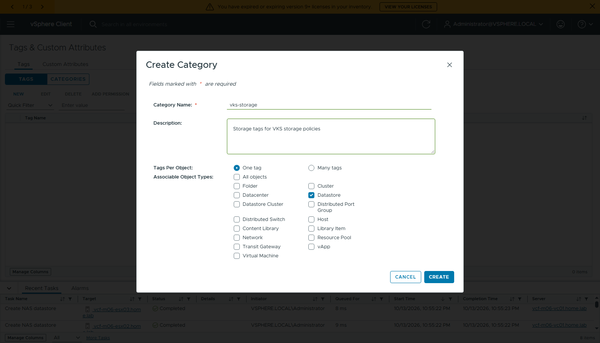
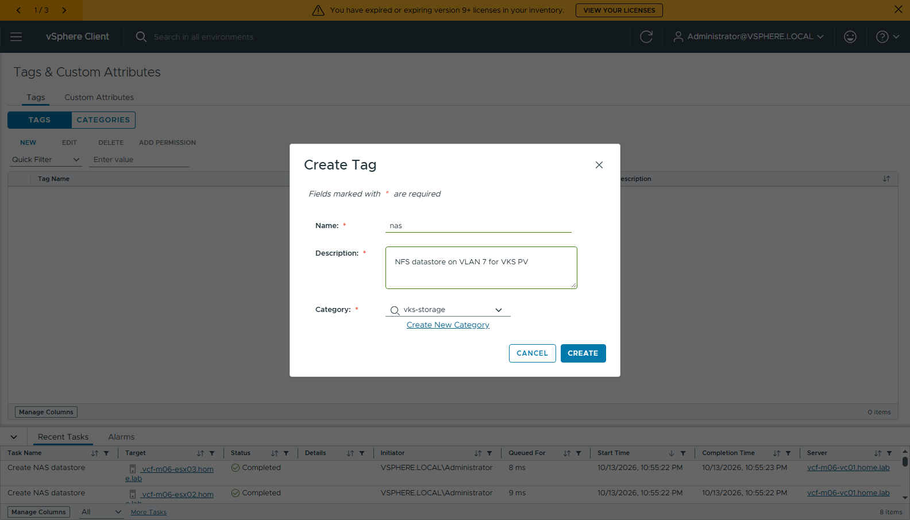
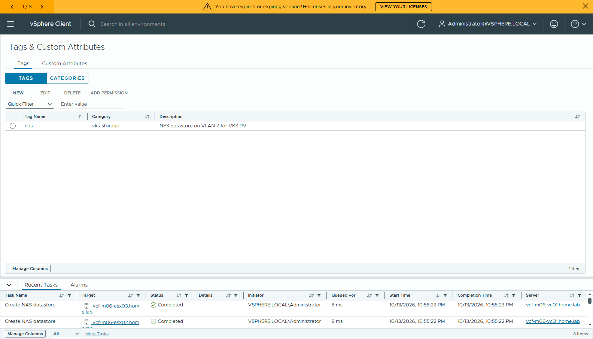
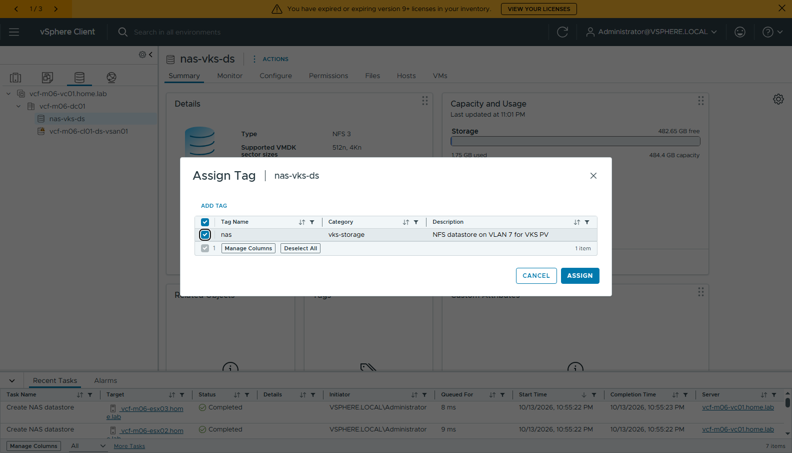
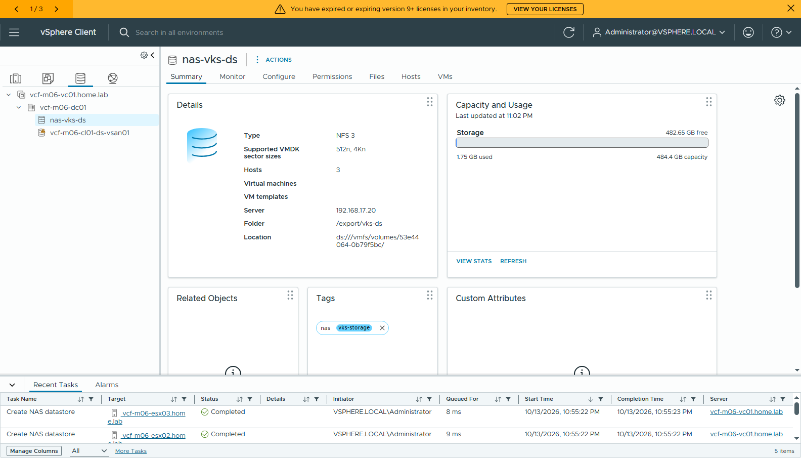

### C-1-5 Storage policy `vks-nas`

**Policies and Profiles → VM Storage Policies → CREATE**：

| 精靈頁 | 設定 |
|---|---|
| Name and description | Name `vks-nas`，**K8s Compliant Name 自己填 `vks-nas`**（不會自動帶出；VKS 的 StorageClass 就叫這個名字） |
| Policy structure | 只勾 **Enable tag based placement rules** |
| Tag based placement | Tag category `vks-storage` → Use storage tagged with → BROWSE TAGS → `nas` |
| Storage compatibility | 只有 `nas-vks-ds`（NFS 3）——vSAN 不在清單裡就對了 |


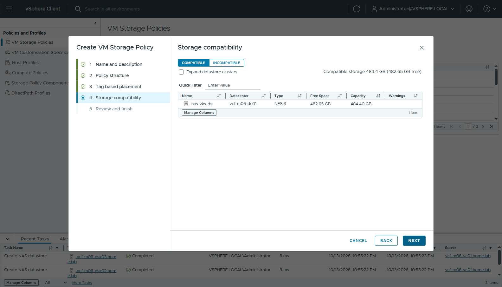
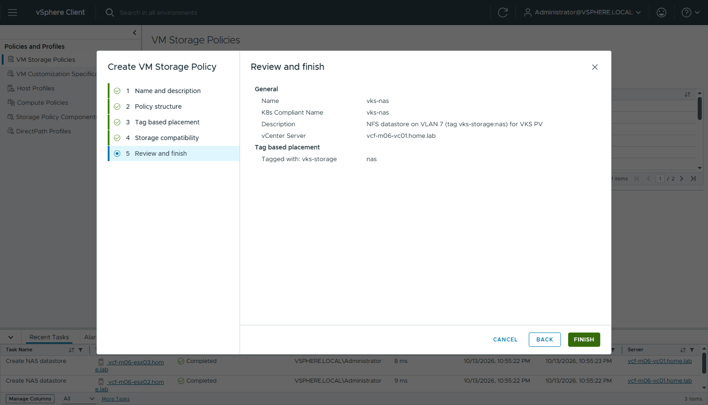


到這裡 NFS 這條線已經完成，**NSX 完全沒有為 NFS 做任何設定**。

## C-2 Transit Gateway + VNA（UI）

**Networks → Transit Gateways**：bring-up 已建立 **Default Transit Gateway**，Connection 是 None → **SETUP NETWORK CONNECTIVITY**：

| 頁 | 設定 |
|---|---|
| 1 Transit Gateway Connectivity | VLAN-backed 只有 **Distributed VLAN Connection**；NEXT 時的 *Networking Prerequisites* 勾 Select All → CONTINUE |
| 2 External Network Connectivity | VLAN ID **6**；Gateway CIDR **`192.168.16.254/24`**（輸入後按 Enter）；External IP Blocks → **Create New** `vks-block` = `192.168.16.0/24`，Excluded `192.168.16.240-192.168.16.254` |
| 3 VPC Services | VNA cluster `vks-vna`、Form Factor **Large**；ADD 節點 `vcf-m06-vna01a.home.lab`、cluster `vcf-m06-cl01`、vSAN、Static `10.0.1.209/23`、gw 10.0.0.1、port group `SDDC-DPortGroup-VM-Mgmt` |
| 4 Review and Deploy | DEPLOY |


> 🔑 這裡**只有 VLAN 6**。VLAN 7（NAS）不要加進 Transit Gateway、也不要建成 External Connection——NFS 不屬於 VPC，加進來反而會讓 NAS 流量有機會繞進 NSX。

## C-3 VKr — Local Content Library + 匯入本機檔案（UI）

**Content Libraries → CREATE**：`vkr-local` → **Local content library**（不開 publishing）→ 不套 security policy → storage 選 vSAN（library 放 vSAN 即可，NAS 只放 PV）。


`vkr-local` → **ACTIONS → Import item** → **Local file** → **UPLOAD FILES** 一次選 4 個檔案（`.ovf`、`-disk1.vmdk`、`.mf`、`.cert`）→ Item name 自動帶 `photon-5-amd64-v1.36.2---vmware.2-vkr.3` → IMPORT。


上傳約 8 分鐘（和 VNA 部署同時進行；**上傳期間不要重新整理這個瀏覽器分頁**，上傳是瀏覽器在送），完成後 1 個 OVF template，11.87 GB：


## C-4 啟用 Supervisor（UI）

VNA 變成 UP 後（這次約 15 分鐘，和 VKr 上傳同時），Transit Gateway 狀態 **Success**（Connection = Distributed VLAN、External Connection = `Distributed-vlan-connection-6`）：


**Supervisor Management → GET STARTED**：

| 精靈頁 | 設定 |
|---|---|
| 1 vCenter Server and Network | **VCF Networking with VPC (recommended)** |
| 2 Supervisor location | **Cluster deployment**：`vcf-m06-sv01`、`vcf-m06-cl01`、zone `vz-01` |
| 3 Storage | Control Plane / Ephemeral Disks / Image Cache 都選 `vks-ftt0`（vSAN）。**不要選 `vks-nas`**：Supervisor 控制平面放 vSAN，NAS 只放 VKS 的 PV |
| 4 Management Network | Static、`SDDC-DPortGroup-VM-Mgmt`、10.0.1.222-10.0.1.226、255.255.254.0、gw 10.0.0.1、DNS 10.0.0.200、search domain home.lab、NTP 10.0.1.254 |
| 5 Workload Network | NSX Project Default、VPC Connectivity Profile Default、External IP Blocks 自動帶出 `vks-block`；DNS 10.0.0.200、NTP 10.0.1.254 |
| 6 Advanced Settings | Control Plane **Small** |


**30 分鐘**（23:24 → 23:54）變成 **Running**，Control Plane Node Address **192.168.16.3**（中途 kubernetes_status 在 ERROR / WARNING / READY 之間跳動屬正常）：


## C-5 讓 Supervisor 和 VKS 信任外部 Harbor（UI）

**Supervisor → Configure → Container Registries → ADD REGISTRY**：Registry Name `harbor01`、Registry host URL `harbor01.home.lab`、TLS Certificate 貼 Harbor 的 **CA 憑證**、帳密留空（`vks-apps` 是 public project）。


Supervisor 建立 `ClusterRegistryConfig`（[`cli/03-cluster-registry-config.txt`](cli/03-cluster-registry-config.txt)），Supervisor Services、Pods、VKS 叢集都會套用，**叢集 YAML 不用另外設 `trust`**。

## C-6 Kubernetes Service library + Namespace（UI）

**Supervisor → Configure → General → Kubernetes Service → ADD** → 勾 `vkr-local` → ADD：


從本機匯入的 VKr 自動產生 KubernetesRelease（[`cli/02-kr.txt`](cli/02-kr.txt)）：

```text
NAME                       VERSION                  READY   COMPATIBLE
v1.36.2---vmware.2-vkr.3   v1.36.2+vmware.2-vkr.3   True    True
```

**Namespaces → NEW NAMESPACE**：Supervisor `vcf-m06-sv01` → Name `vks-lab` → zone `vz-01` → FINISH。


Namespace Summary：

- **ADD STORAGE**：勾 **`vks-ftt0`**（節點磁碟，vSAN）和 **`vks-nas`**（PV，NAS）兩個
- **ADD VM CLASS**：`best-effort-xsmall` / `best-effort-small` / `best-effort-medium`


加完 storage policy，Supervisor 自動產生同名的 StorageClass（各一個 Immediate + `-latebinding`）：

```text
$ kubectl get sc | grep vks-
vks-ftt0               csi.vsphere.vmware.com   Delete   Immediate              true
vks-ftt0-latebinding   csi.vsphere.vmware.com   Delete   WaitForFirstConsumer   true
vks-nas                csi.vsphere.vmware.com   Delete   Immediate              true
vks-nas-latebinding    csi.vsphere.vmware.com   Delete   WaitForFirstConsumer   true
```

## C-7 Public SubnetSet（UI）

Namespace → **Resources** → Network → **GO TO SERVICE** → **SubnetSets → NEW SUBNETSET**：Name `public`、Access Mode **Public**、16 IPs、DHCP None → CREATE（[`cli/04-subnetset.txt`](cli/04-subnetset.txt)）。


> ℹ️ Resources 第一次開啟時如果停在別的頁面（例如先前刪掉的叢集），按麵包屑的 `vks-lab` 回到 namespace 首頁。

## C-8 VKS 叢集（UI，Custom Configuration）

Resources → Kubernetes → **CREATE CLUSTER** → **Custom Configuration**：

| 精靈頁 | 設定 |
|---|---|
| General | Name `vks-cl01`、ClusterClass `builtin-generic-v3.7.0`、Kubernetes release v1.36.2、VM class `best-effort-medium`、**Storage Class `vks-ftt0`**（節點系統碟放 vSAN） |
| General → Storage → Persistent Volume Storage | **Default Storage Class = `vks-nas`**（guest cluster 裡的預設 StorageClass 就是 NAS） |
| General → Network → Node Network | **Use custom primary network** → `public (Subnet Set)` |
| Control Plane | 1 台、Photon |
| Node Pools | node pool 改名 `vks-cl01-np-1`，Overrides 的 VM class 改 `best-effort-small` |


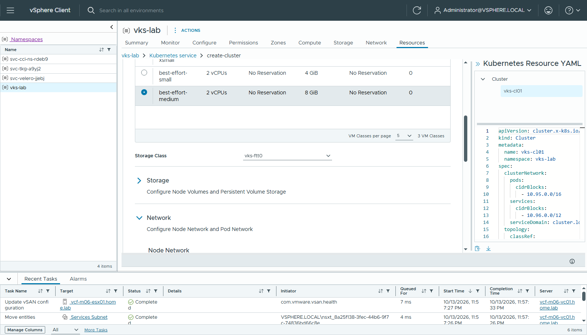
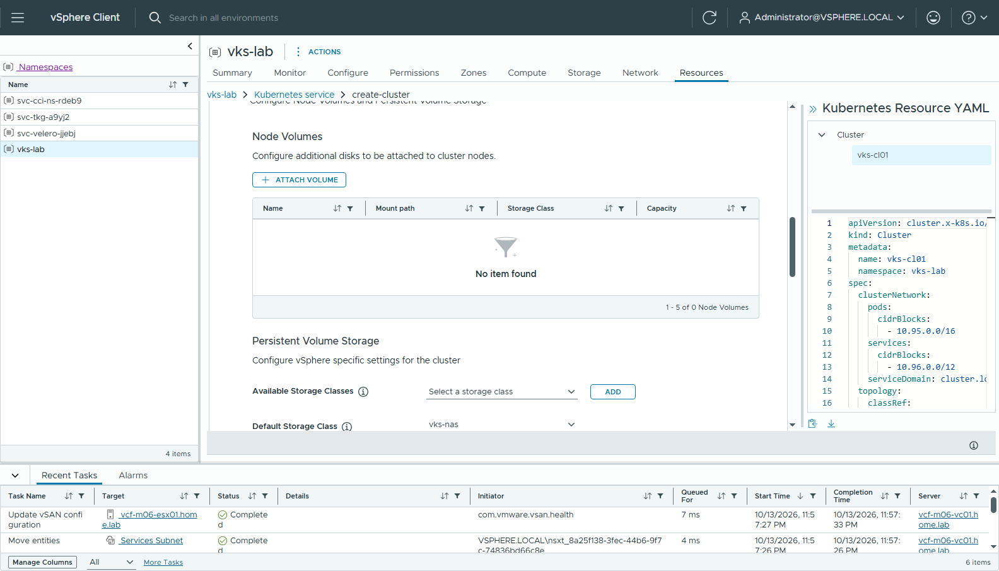


> ⚠️ 回頭展開 **General Settings** 修改任何欄位，精靈會把 **Node Network** 和 **Node Pools** 的自訂值重設（primary network 變回自動產生、node pool 名稱和 VM class override 消失）。改完要回去重選，送出前看右側 YAML 確認 `networks` 和 `overrides` 都還在。

精靈產生的 YAML（[`manifests/vks-cl01.yaml`](manifests/vks-cl01.yaml)）：

```yaml
    variables:
      - name: vmClass
        value: best-effort-medium
      - name: storageClass
        value: vks-ftt0            # 節點系統碟 → vSAN
      - name: vsphereOptions
        value:
          persistentVolumes:
            defaultStorageClass: vks-nas   # guest 預設 StorageClass → NAS
      - name: networks
        value:
          interfaces:
            primary:
              network: {name: public, kind: SubnetSet, apiVersion: crd.nsx.vmware.com/v1alpha1}
```

**沒有任何和 registry、NFS 有關的設定**：Harbor CA 由 C-5 下發；NAS 對 VKS 來說只是一個 StorageClass。

第一次按 FINISH（Supervisor Running 後 15 分鐘）被擋：

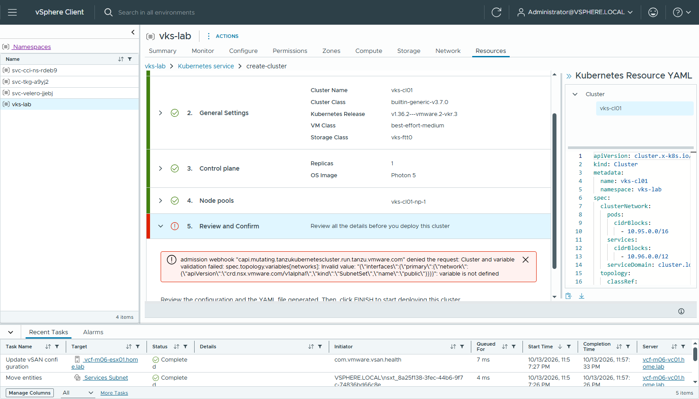

```text
admission webhook "capi.mutating.tanzukubernetescluster.run.tanzu.vmware.com" denied the request:
spec.topology.variables[networks]: Invalid value: ...: variable is not defined
```

Supervisor 剛 Running 時 VKS 的 webhook 還沒拿到 ClusterClass 的 `networks` 變數。用 `kubectl apply --dry-run=server -f vks-cl01.yaml` 測，通過後（這次 1 分鐘內）在精靈**再按一次 FINISH** 即可，不用重填。


約 **6 分鐘**（00:11 → 00:17）變成 **Available**，CP 192.168.16.50、worker 192.168.16.51：


## C-9 驗證（CLI + vCenter 效能圖）

```bash
kubectl vsphere login --server=192.168.16.3 -u administrator@vsphere.local --insecure-skip-tls-verify \
  --tanzu-kubernetes-cluster-namespace vks-lab --tanzu-kubernetes-cluster-name vks-cl01
kubectl config use-context vks-cl01
```

### C-9-1 節點與 StorageClass

[`cli/05-guest-nodes-sc.txt`](cli/05-guest-nodes-sc.txt)：兩個節點 Ready；guest 裡的 **`vks-nas` 是 default StorageClass**（精靈設的 `defaultStorageClass`）：

```text
NAME                   PROVISIONER              VOLUMEBINDINGMODE
vks-ftt0               csi.vsphere.vmware.com   Immediate
vks-ftt0-latebinding   csi.vsphere.vmware.com   WaitForFirstConsumer
vks-nas (default)      csi.vsphere.vmware.com   Immediate
vks-nas-latebinding    csi.vsphere.vmware.com   WaitForFirstConsumer
```

### C-9-2 Air-gap：image 只從 Harbor 來

[`manifests/nginx-harbor.yaml`](manifests/nginx-harbor.yaml)（[`cli/06-nginx-from-harbor.txt`](cli/06-nginx-from-harbor.txt)）：

```text
Image:  harbor01.home.lab/vks-apps/nginx-unprivileged:1.30.4-alpine
kubelet: Successfully pulled image "harbor01.home.lab/vks-apps/nginx-unprivileged:1.30.4-alpine"
nginx-lb   LoadBalancer   10.110.46.25   192.168.16.33   80:31982/TCP
$ curl -s http://192.168.16.33/ | grep title      # 從管理網段
<title>Welcome to nginx!</title>
```

反向測試 [`manifests/pull-test.yaml`](manifests/pull-test.yaml)（[`cli/07-pull-test.txt`](cli/07-pull-test.txt)）：同一個 busybox，`docker.io` 拉不到、Harbor 拉得到：

```text
from-dockerhub   0/1   ImagePullBackOff   ← Head "https://registry-1.docker.io/v2/...": dial tcp ...:443: i/o timeout
from-harbor      0/1   Completed          ← hello-from-harbor，並且 wget 到 nginx-lb
```

### C-9-3 PV 落在 NAS

[`manifests/pvc-nas.yaml`](manifests/pvc-nas.yaml)：PVC `storageClassName: vks-nas` + 一個寫檔的 Pod（[`cli/13-pvc-on-nas.txt`](cli/13-pvc-on-nas.txt)）：

```text
data-on-nas   Bound   pvc-9bf1617d-...   5Gi   RWO   vks-nas
/dev/sdb on /data type ext4 (rw,relatime)          ← Pod 看到的是一顆區塊磁碟，不是 NFS
hello from NAS PV ...

$ kubectl -n vks-lab get pvc      # Supervisor 端
cf2b08b2-...-9bf1617d-...         5Gi    vks-nas     ← guest 的 PV
vks-cl01-mqr72-xhxtr-1987f94d     20Gi   vks-ftt0    ← 節點系統碟（vSAN）
vks-cl01-vks-cl01-np-1-...        20Gi   vks-ftt0
```

vCenter **叢集 → Monitor → Cloud Native Storage → Container Volumes**：PV 的 Datastore 是 `nas-vks-ds`，節點碟在 vSAN：

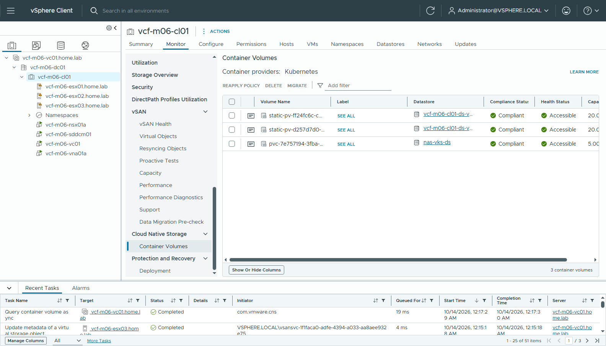

NAS 上就是一顆 FCD VMDK（[`cli/14-nas-fcd-files.txt`](cli/14-nas-fcd-files.txt)）：

```text
/export/vks-ds/fcd/617951ff5f5546cbae092bf04044aa02-flat.vmdk   5368709120（thin）
```

### C-9-4 NFS 流量沒有經過 VNA（重點）

在 Pod 裡往 NAS PV 寫 1 GiB，同時看 NAS 收到多少、VNA 和 worker VM 的網路 / 虛擬磁碟計數器；再用**同一個 1 GiB 檔案經 VPC LoadBalancer 下載**當對照組（[`manifests/path-control-lb.yaml`](manifests/path-control-lb.yaml)）。量法：vCenter realtime 效能計數器（[`scripts/Measure-VmTraffic.ps1`](scripts/Measure-VmTraffic.ps1)）+ NAS 的 `eth0 rx_bytes`。完整輸出：[`cli/15-nfs-path-proof.txt`](cli/15-nfs-path-proof.txt)。

| 測試 | NAS 收到 | VNA 網路（收 / 送） | worker 網路（收 / 送） | worker 虛擬磁碟寫入 |
|---|---|---|---|---|
| **A. Pod 寫 1 GiB 到 NAS PV** | **1025 MiB** | **0.7 / 0.7 MB** | 0.1 / 0.1 MB | **1074 MB** |
| B. 對照：同一個 1 GiB 經 VPC LB 下載 | — | **1083 / 1083 MB** | 12 / 1073 MB | 2 MB |

- A：worker 的 1 GiB 是「虛擬磁碟寫入」，不是網路流量；ESXi 把它轉成 NFS、從 vmk3 送到 NAS。VNA 幾乎是 0。
- B：只要是走 VPC 的流量，VNA 一定看得到（1 GiB 進、1 GiB 出）——證明 A 的 0 不是量不到，而是真的沒經過。
- NAS 上的 NFS 連線只來自三台 ESXi 的 vmk3：

```text
$ ss -tn state established '( sport = :2049 )'      # NAS 上
192.168.17.20:2049  192.168.17.23:804
192.168.17.20:2049  192.168.17.22:912
192.168.17.20:2049  192.168.17.21:728
```

vCenter 效能圖（Real-time）。VNA 的網路只有在對照組 B 時出現大峰值；寫入 NAS 的時段在 worker 的 **Virtual Disk Rate**，不在任何網路圖上：


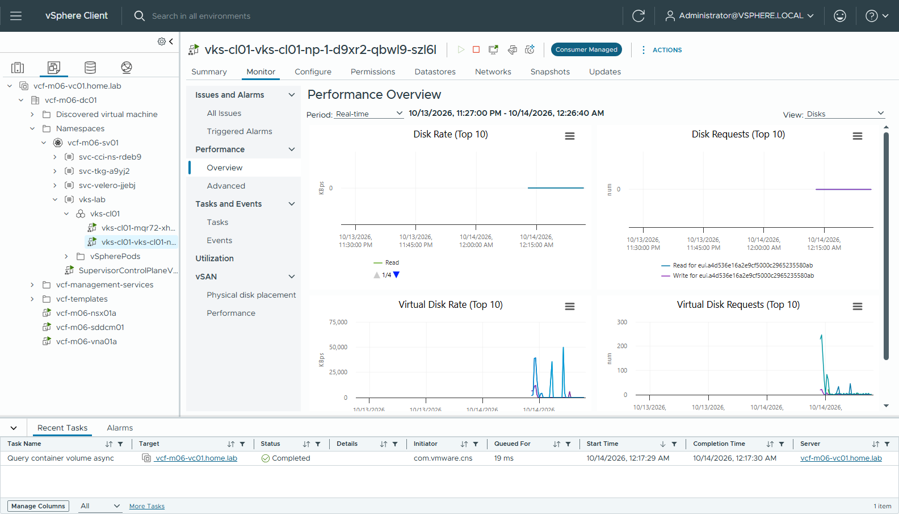
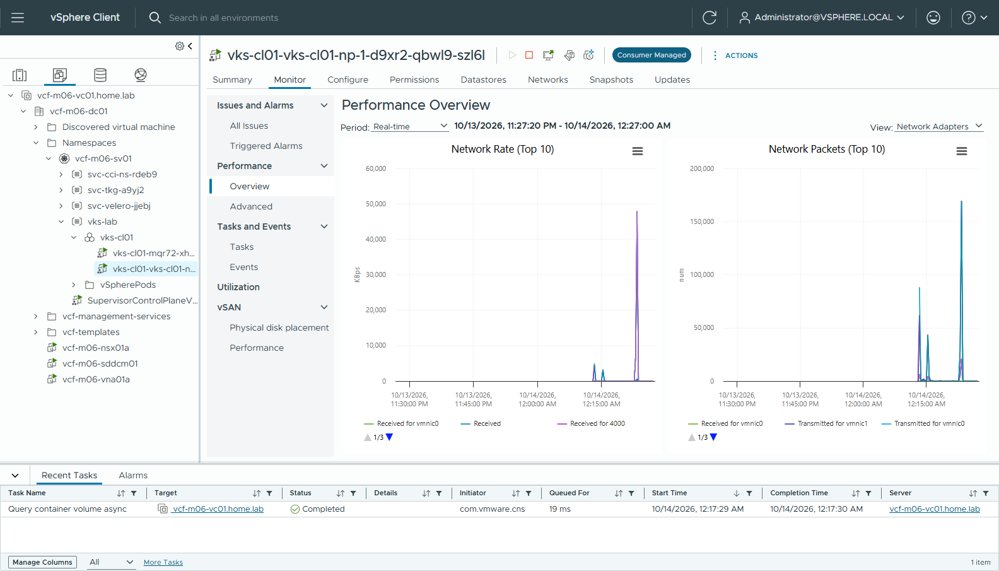

> ℹ️ 量 VNA 要加總 vNIC 以外的 instance：VNA 的資料面流量在 vCenter 效能計數器裡記在 `vmnic0` / `vmnic1` 這兩個 instance，VM 彙總值（instance 空字串）不含它。一般 VM（worker）則記在 vNIC `4000`。腳本取「最忙的那個 instance」，避免同一筆流量同時記在 vNIC 和 vmnic 上被重複計算。
>
> ℹ️ 效能計數器用 vCenter 的時間。這個 lab 的跳板機（AD/DNS 主機）時鐘比 vCenter 快約 160 秒，腳本會先取 vCenter 時間換算。

## 時間

| 階段 | 時間 |
|---|---|
| nested ESX ×3 部署 | 3 分鐘 |
| A-1 Installer 精靈 + 驗證 | 約 35 分鐘（驗證 15 項約 5 分鐘） |
| bring-up：vCenter → SDDC Manager → vSphere cluster → NSX | 2 小時 14 分鐘 |
| A-2 中止 + 確認 | 2 分鐘（另外觀察 30 分鐘沒有重送） |
| A-3 前置準備 | 約 20 分鐘 |
| C-1 NFS 儲存（port group、vmk3 ×3、datastore、tag、policy） | 約 15 分鐘 |
| C-2 Transit Gateway + VNA | 15 分鐘（23:05 → 23:20，和 VKr 上傳同時） |
| C-3 VKr 上傳 | 8 分鐘（23:09 → 23:17） |
| C-4 Supervisor | **30 分鐘**（23:24 → 23:54） |
| C-5 ~ C-7 Harbor 信任、library、namespace、SubnetSet | 約 15 分鐘 |
| C-8 VKS 叢集 | **6 分鐘**（00:11 → 00:17） |

## 遇到的問題

| # | 症狀 | 原因 / 處理 |
|---|---|---|
| 1 | Installer 剛開機登入後跳 *Service Interruption — Multiple services are currently down* | Installer 服務還在啟動，等幾分鐘再 RELOAD |
| 2 | 驗證出現 *Insufficient Storage. 5400 GB storage is less than the required 6748 GB* | UI 精靈的 vSAN FTT 固定為 1，而且需求含 VCFMS 的 2900 GB。這次不部署 VCFMS，所以 ACKNOWLEDGE 即可（nested ESX 的 capacity 碟先線上擴到 3600 GB） |
| 3 | 中止後 SDDC Manager 的 `VSP_BOOTSTRAP` 任務從 Pending 變成 Failed | `domainmanager` 重啟後曾接手，但 *Bootstrap VCF Services Platform* 失敗，沒有建立任何 VM；之後 30 分鐘沒有重送。**不要**在 Installer 按 RETRY |
| 4 | Storage policy 的 K8s Compliant Name 沒有自動帶出 | 自己填 `vks-ftt0`（Supervisor 精靈會用到這個名稱） |
| 5 | 要從 vmk ping VLAN 6 閘道，但 nested ESX 的 SSH 連不上 | bring-up 後 SSH 是關的；用 PowerCLI `Get-EsxCli -V2` 透過 vCenter 執行 `esxcli network diag ping`，不必開 SSH |
| 6 | `kubectl -n vks-lab get clusterclass` 只看到 v3.1.0-v3.3.0 | v3.4.0-v3.7.0 在 `vmware-system-vks-public` namespace；叢集 YAML 的 `classRef.namespace` 本來就指向那裡 |
| 7 | Port group 建出來 VLAN 是 1、Number of ports 是 7 | 自動化填錯欄位（填到 Number of ports）。UI 上照著 VLAN ID 欄位填即可；建錯就刪掉重建 |
| 8 | NFS datastore 的 Folder 變成 `C:/Program Files/Git/export/vks-ds` | Git Bash 把 `/export/...` 當成路徑轉換（自動化才會遇到）；`MSYS_NO_PATHCONV=1` |
| 9 | VKS 精靈回頭改 General Settings 後，Node Network 和 Node Pools 的自訂值不見 | 精靈的行為；改完要重選 `public (Subnet Set)`、重新編輯 node pool，送出前看 YAML |
| 10 | 第一次 FINISH 被擋：`variables[networks] ... variable is not defined` | Supervisor 剛 Running，VKS webhook 還沒同步 ClusterClass 變數；`kubectl apply --dry-run=server` 通過後再按 FINISH |
| 11 | NAS 上 `ss` 還看到已刪除 VM 的 NFS 連線（先前附錄做法測試留下的 192.168.17.65/.66） | 對端已不存在的殘留 socket；`sudo ss -K dst <IP>` 清掉 |
| 12 | NSX 的 Transit Gateway attachment statistics 不會即時更新（停在幾分鐘前的值） | 不適合拿來比對短時間的流量；改用 vCenter realtime 效能計數器 |

## 附錄：RWX 的另一種做法

本文的 PV 是 NFS datastore 上的 VMDK，access mode 是 **RWO**。如果應用需要 **RWX**（多個節點同時讀寫同一個目錄），另一種做法是讓 VKS 節點多一張 eth1 接 VLAN 7、在 guest 裡裝 NFS CSI driver 直接掛 NAS。那條路要在 NSX 建 *Dedicated to Subnet* 的 Distributed VLAN Connection 和 VLAN 延伸 Subnet（static IP allocation 只能用 API 開），NFS 流量走節點的 eth1（仍在 VLAN 7，不經過 VNA，但會經過 NSX 的 VLAN 延伸 subnet）。完整步驟與驗證見 [kostenyang/vks-airgap-novcfms — vpc-nas-pv 做法 2](https://github.com/kostenyang/vks-airgap-novcfms/blob/main/ui-step-by-step/vpc-nas-pv/README.md)。

| | 本文：ESXi NFS datastore | 附錄：VKS eth1 + NFS CSI |
|---|---|---|
| Access mode | RWO | RWX |
| NFS 流量 | ESXi vmk3 | VKS 節點 eth1 |
| NSX 設定 | 無 | DVC（Dedicated to Subnet）+ VLAN 延伸 Subnet（API） |
| guest 要裝 | 無（內建 vSphere CSI） | NFS CSI driver（image 要先推進 Harbor） |

## 檔案

| 路徑 | 內容 |
|---|---|
| `img/` | 截圖：`0-bringup/`（Installer 精靈）、`0-prep/`（前置準備）、`1xx` NFS 儲存、`23x` TGW/VNA、`24x` VKr、`35x` Supervisor、`46x-48x` Harbor/namespace/SubnetSet、`58x-59x` VKS 叢集、`69x` 驗證；`diagram/` 架構圖原始檔 |
| `cli/` | 各步驟的指令輸出 |
| `manifests/` | VKS 叢集 YAML（精靈產生）、驗證用的 nginx / pull-test / PVC / LB 對照組 |
| `scripts/abort_watcher.py` | 監看 bring-up，在 VCF Management Platform 開始時自動中止（+ `installer_api.py`、`installer_root.py`） |
| `scripts/nas/` | NAS 離線打包、部署、安裝 |
| `scripts/*.ps1` | vmk3 ping NAS、ESXi NFS 連線來源、VM 流量計數（PowerCLI，經 vCenter，不必開 ESXi SSH） |

腳本不含密碼，執行前用環境變數提供（`LAB_PASSWORD`、`VCPASS`、`VIPASS`、`NFSPASS`）。IP / FQDN 是 lab 值，請依環境修改。
