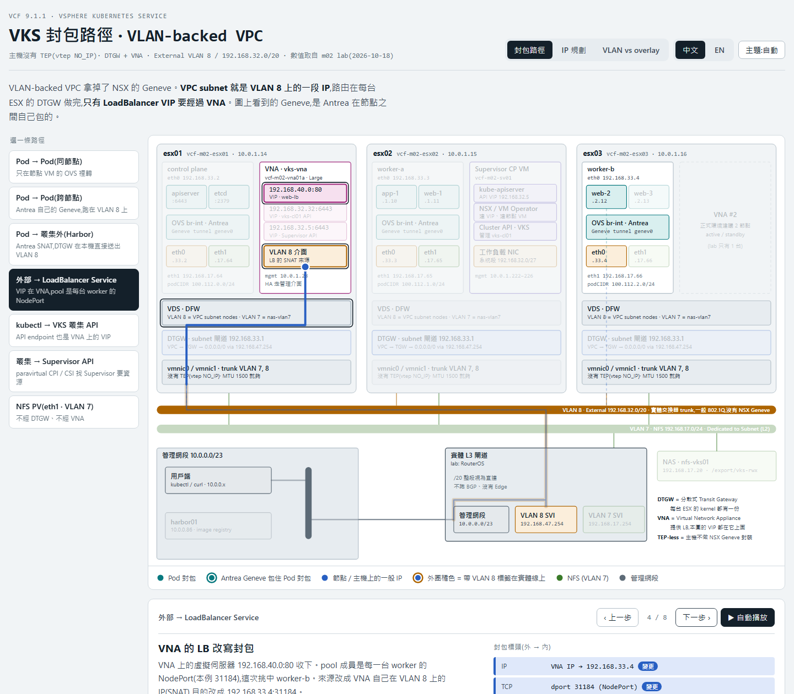
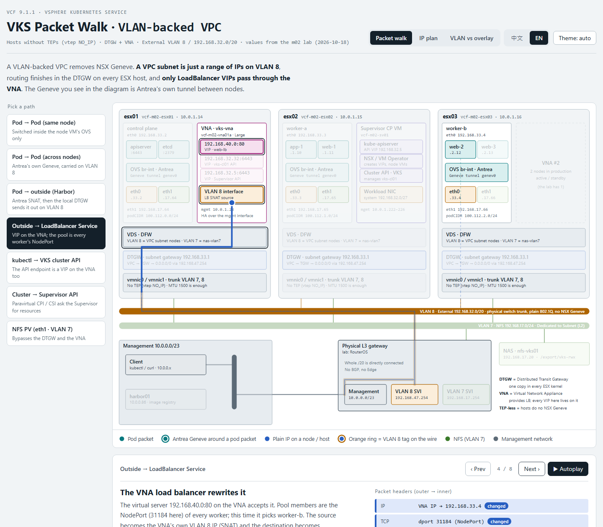

# VKS 封包路徑 · VLAN-backed VPC / VKS Packet Walk · VLAN-backed VPC

[中文](#中文) · [English](#english)

## 中文

一個單一 HTML 檔的互動圖，一跳一跳走過 **VCF 9.1.1 VKS 跑在 VLAN-backed VPC**（主機沒有 TEP、DTGW + VNA）時封包怎麼走。數值取自本 repo 的 [m02 版](../m02-vlan-vpc-vna-nfs-eth1/)（2026-10-18 建置）。

**怎麼開**

- 直接用瀏覽器開 [`index.html`](index.html)，不用架 server。
- 不載入任何外部資源（字型、CDN 都沒有），air-gap 環境也能開。
- 右上角可以切 **中文 / EN** 和主題（自動 / 深色 / 淺色）。也可以在網址加 `?lang=en` 或 `?lang=zh` 指定語言。
- 鍵盤 ← → 切換步驟。

**內容**

| 視圖 | 內容 |
|---|---|
| 封包路徑 | 7 條路徑逐跳動畫，每一步顯示封包標頭（外 → 內），標出新增、變更、拿掉的欄位；下方附**這一跳的抓包指令**（含 DR / SR），可直接複製 |
| IP 規劃 | External VLAN 8 的 192.168.32.0/20 照比例切法、VIP 配置規則（m02 實測三次）、叢集內部網段 |
| VLAN vs overlay | 和 overlay VPC（FULL_STACK_VPC）的 11 項差異、VNA 容量 |
| 抓包準備 | 在 lab 跑抓包要先做的事（變數、netshoot 進 Harbor、privileged namespace、demo、節點 debug shell、ESXi pktcap-uw、DR / SR 在哪、RouterOS），加上所有路徑的指令總表 |

**抓包**

- 每一跳都標出指令在哪裡跑：你的電腦（kubectl）、節點 debug shell、ESXi、DR（ESXi 上的 DTGW）、SR（VNA）、RouterOS、Harbor、NAS。
- 練習用的 demo 在 [`lab/pw-demo.yaml`](lab/pw-demo.yaml)：圖上的 app-1 = `pw-app`，web-1 / web-2 = `pw-web` 的兩個 Pod，image 用 Harbor 裡已有的 nginx-unprivileged 與 busybox。
- 變數預設是 m01 的值（Supervisor VIP 192.168.32.6、namespace `vks-lab`、叢集 `vks-cl01`）。
- 🔴 這些指令照 m01 / m02 實測過的架構整理，**還沒在 lab 從頭到尾跑過**；VNA 的 CLI 預期和 NSX Edge 相同但未驗證。

7 條路徑：

1. Pod → Pod（同節點）：只在節點 VM 的 OVS 裡轉
2. Pod → Pod（跨節點）：Antrea 自己的 Geneve，跑在 VLAN 8 上
3. Pod → 叢集外（Harbor）：Antrea SNAT，DTGW 在本機直接送出 VLAN 8
4. 外部 → LoadBalancer Service：VIP 在 VNA，pool 是每台 worker 的 NodePort
5. kubectl → VKS 叢集 API：API endpoint 也是 VNA 上的 VIP
6. 叢集 → Supervisor API：paravirtual CPI / CSI 找 Supervisor 要資源
7. NFS PV（eth1 · VLAN 7）：不經 DTGW、不經 VNA

**註記**

- 哪台 VM 放在哪台主機、Pod IP 與 podCIDR 的分配順序是示意。
- Antrea 以預設 encap 模式（Geneve）描述。
- 回程封包在 VLAN 8 上由誰回 ARP，lab 沒有抓包確認，圖上只畫到「送回 VM 所在主機」。

## English

A single-file interactive diagram that walks, hop by hop, through how packets move when **VCF 9.1.1 VKS runs on a VLAN-backed VPC** (hosts without TEPs, DTGW + VNA). The values come from the [m02 build](../m02-vlan-vpc-vna-nfs-eth1/) in this repo (built 2026-10-18).

**How to open**

- Open [`index.html`](index.html) in a browser. No server is needed.
- It loads nothing external (no web fonts, no CDN), so it also works in air-gapped environments.
- Use the **中文 / EN** switch and the theme button (auto / dark / light) in the top right, or add `?lang=en` / `?lang=zh` to the URL.
- The ← → keys move between steps.

**Views**

| View | What it shows |
|---|---|
| Packet walk | 7 paths animated hop by hop. Each step lists the packet headers (outer → inner) and marks new, changed and removed fields, followed by **capture commands for that hop** (DR and SR included) with copy buttons |
| IP plan | The External VLAN 8 192.168.32.0/20 carved to scale, the VIP allocation rule (three attempts on m02), and the in-cluster ranges |
| VLAN vs overlay | 11 differences from an overlay VPC (FULL_STACK_VPC), plus VNA capacity |
| Capture setup | What to prepare before capturing in the lab (variables, netshoot in Harbor, a privileged namespace, the demo, node debug shells, ESXi pktcap-uw, where the DR and SR are, RouterOS), plus every command grouped by path |

**Captures**

- Each hop says where its commands run: your PC (kubectl), a node debug shell, ESXi, the DR (DTGW on ESXi), the SR (VNA), RouterOS, Harbor or the NAS.
- The practice demo is [`lab/pw-demo.yaml`](lab/pw-demo.yaml): app-1 in the diagram = `pw-app`, web-1 / web-2 = the two `pw-web` pods, using the nginx-unprivileged and busybox images already in Harbor.
- The variables default to the m01 values (Supervisor VIP 192.168.32.6, namespace `vks-lab`, cluster `vks-cl01`).
- 🔴 The commands follow the architecture measured on m01 / m02 but **have not been run end to end in the lab yet**; the VNA CLI is expected to match the NSX Edge CLI but is untested.

The 7 paths:

1. Pod → Pod (same node): switched inside the node VM's OVS only
2. Pod → Pod (across nodes): Antrea's own Geneve, carried on VLAN 8
3. Pod → outside (Harbor): Antrea SNAT, then the local DTGW sends it out on VLAN 8
4. Outside → LoadBalancer Service: VIP on the VNA; the pool is every worker's NodePort
5. kubectl → VKS cluster API: the API endpoint is a VIP on the VNA too
6. Cluster → Supervisor API: paravirtual CPI / CSI ask the Supervisor for resources
7. NFS PV (eth1 · VLAN 7): bypasses the DTGW and the VNA

**Notes**

- Which host runs which VM, the pod IPs and the order of podCIDR allocation are illustrative.
- Antrea is shown in its default encap (Geneve) mode.
- Who answers ARP for return traffic on VLAN 8 was not captured in the lab, so the diagram stops at "back to the host where the VM runs".

## 參考 / References

- William Lam: [VCF 9.1.1 simplified VKS using VLAN-backed VPCs without NSX TEPs](https://williamlam.com/2026/09/vcf-9-1-1-simplified-vsphere-kubernetes-service-vks-using-vlan-backed-vpcs-without-nsx-tunnel-endpoints-teps.html)
- 逐跳動畫的點子來自 / The hop-by-hop idea comes from [vconfig.pl NSX Overlay Packet Walk](https://vconfig.pl/nsxpacketflow/)
